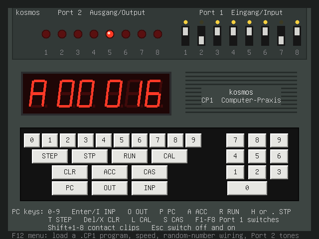

# Kosmos CP1 for MiSTer

The Kosmos CP1 "Computer-Praxis" (1983), an experimental computer built around an Intel 8049,
as a [MiSTer](https://github.com/MiSTer-devel/Main_MiSTer/wiki) core. It runs the original 8049
firmware ROM; the two 8155 RAM/I/O chips, keypad, six-digit display, Port 1 and Port 2, and the
CP3 memory expansion (cells 128-255, Ports 3-5) are wired as in the
[browser emulator](https://lambdamikel.github.io/kosmos-cp1-emulator/)
([source](https://github.com/lambdamikel/kosmos-cp1-emulator)), which follows Andreas Signer's
[kosmos-cp1](https://github.com/asig/kosmos-cp1) emulator.

The 8049 and the board are a port of the browser emulator's core, and they are checked against
it instruction by instruction (see *Verification*).



This is version 1.0; the F12 menu shows the version and build date.

## Installation

- Copy `releases/KosmosCP1_<date>.rbf` to `_Computer/` on the SD card.
- Copy `dist/games/KosmosCP1/` to `games/KosmosCP1/`: 63 programs, 15 from the browser
  emulator's guide and 48 from the Kosmos manual.

## Keys

| PC key | CP1 |
|---|---|
| `0`–`9` (and the number pad) | digit keys |
| `Enter`, `I` | INP |
| `O` | OUT |
| `P` | PC |
| `A` | ACC |
| `R` | RUN |
| `H`, `.` | STP |
| `T` | STEP |
| `Delete`, `Backspace`, `X` | CLR |
| `L` | CAL |
| `S` | CAS |
| `F1`–`F8` | flip the Port 1 switches (lines 1-8) |
| `Shift` + `1`–`8` | press a contact clip: the Port 1 line goes low while held |
| `Esc` | switch off and on |
| `F12` | MiSTer menu |

These are the browser emulator's keys. A key tap is held for at least 24,000 machine cycles
(60 ms), so the firmware's keypad scan always sees it.

## Menu

- **Load program**: a `.CP1` file. This is the browser emulator's text format: `#` or `;` start
  comments, and a cell is a line `NNN mnemonic OO.DDD` (cell address, opcode, operand, all
  decimal; the mnemonic is optional, and `OO.DDD` alone goes to the next cell). The core parses
  the file in hardware as it streams in and writes the cells into the 8155s. Load it once the
  display shows `P  000`, then start the program as usual, e.g. `0 0 0 PC RUN`. Every file says
  in its header where to start and what it needs.
- **Speed**: Original (400,000 machine cycles per second, the 6 MHz crystal / 15), 4×, 16× or ¼×.
- **Random-number wiring**: the manual's wiring of Port 2 back to Port 1 (Bild 65; lines 1-8 to
  3, 4, 2, 1, 7, 8, 6, 5).
- **Tone generators on Port 2**: the manual's melody generator, one tone per line (c d e f g a h c').
- **Tone generator on Port 4**: the tone generator the manual's programs drive from Port 4; the
  value sets the pitch in semitone steps from middle C (0 and 255 are silent). The pitch mapping
  is the browser emulator's assumption, not measured on a real Kosmos tone generator.

## Screen

The picture is drawn at 640×480: the I/O module with the Port 2 LEDs and the Port 1 switches
(with a lamp per line showing its level), the six-digit display, and the keypad, where held keys
light up. Display segments show how long they were on (averaged over 16,384 machine cycles), so
the multiplexed display looks as it does on the real thing.

## Not (yet) included

- The CP2 cassette interface (CAL and CAS have nothing to talk to) and the CP5 module.
- Extra circuitry from the manual beyond the contact clips, the random-number wiring and the tone
  generators; programs that need it are left out of `games/KosmosCP1`.

## Verification

`sim/` holds a lockstep test. One scenario script (key presses, Port 1 and Port 3 levels, the
random-number wiring, program loads, switching off and on) drives both the browser emulator's
JavaScript core (`jsref.sh`, in headless Chrome) and this Verilog in Verilator (`tb_lockstep.cpp`).
Both chain a hash of the CPU and timer state after every instruction, and print it along with
hashes of the internal RAM and both 8155s (RAM and registers) at checkpoints. All six scenarios
(boot, keypad entry, guide programs, ports, HANOI and Moon Landing, the memory game with the
random-number wiring and a power cycle) match at every checkpoint, about 12.6 million
instructions in all.

`sim/check_loader.py` streams every `.CP1` file through the hardware loader: all 63 give exactly
the cells the browser emulator's parser gives for the original program text.
`sim/tb_video.cpp` renders frames to PPM files (the screenshot above is one).

The scripts expect a clone of
[kosmos-cp1-emulator](https://github.com/lambdamikel/kosmos-cp1-emulator) at `../../emulator`
(as in `~/claude/cp1/{emulator,mister}`); set `CP1_EMU` to use another path. `jsref.sh` needs
Google Chrome, the rest Verilator.

```
sim/mkscen.py                         # write the scenarios
verilator --cc --exe --build --public-flat-rw --top-module cp1 -Mdir sim/obj rtl/cp1.v rtl/i8049.v sim/tb_lockstep.cpp -o tb_lockstep
sim/obj/tb_lockstep sim/scen_keys.txt > v.txt; sim/jsref.sh sim/scen_keys.txt > j.txt; diff v.txt j.txt
```

## Building

Quartus Prime Lite 17.0 (as for all MiSTer cores): open `KosmosCP1.qpf` and compile, or run
`quartus_sh --flow compile KosmosCP1`. The framework in `sys/` comes from
[Template_MiSTer](https://github.com/MiSTer-devel/Template_MiSTer). `tools/mklayout.py` makes the
screen's text layer, `tools/mktones.py` the Port 4 pitch table, `tools/export-programs.py` the
program files.

## Credits

- Michael Wessel: the browser emulator this core is ported from.
- Andreas Signer: the kosmos-cp1 emulator whose 8049 and board model the browser emulator follows,
  and the CP1 ROM and listings it makes available.
- The 8×16 font is misc-fixed (public domain).
- Made with Claude Opus 5.5 (Claude Code), together with Michael Wessel.

The core is GPL-3. The MiSTer framework in `sys/` keeps its own licence (GPL-2 or later).
The CP1 firmware ROM (`rtl/cp1_rom.hex`) and the programs from the Kosmos manual remain
© Franckh-Kosmos and are not covered by the licence.
